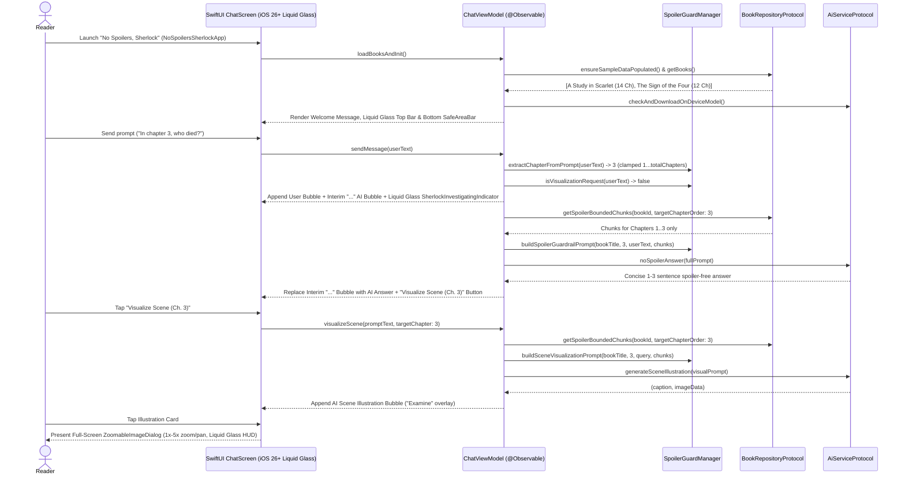

# PRD: No Spoilers, Sherlock — Native iOS Application

- **Document ID**: `prd-0001-no-spoilers-sherlock-ios`
- **Status**: Approved
- **Owner**: Product Manager Agent (`@product-manager`)
- **Architect**: Senior Architect Agent (`@senior-architect`)
- **Target Release**: v1.0.0 (iOS 26+ / macOS 26+ / Swift 6)
- **Target Surfaces**:
  - `frontend/apple/Packages/AppCore/` (Local Swift Package for domain models, spoiler guardrail engine, protocols, sample data, and ViewModel/state logic — 100% pure `Foundation` + `Observation`)
  - `frontend/apple/no-spoilers-sherlock/` (Native SwiftUI iOS 26+ Application with Liquid Glass design)

---

## 1. Context & Problem

### 1.1 Background & User Problem
Readers of mystery novels and multi-book literary universes—such as Sir Arthur Conan Doyle's *Sherlock Holmes* canon—frequently want to ask questions about characters, clues, timelines, or Victorian settings while actively reading a book. Searching the web, wikis, or standard LLM chat assistants almost inevitably exposes major plot twists, culprit identities, or character deaths from later chapters.

The Android reference application (**"No Spoilers, Sherlock"** in `/Users/peterfriese/Workspace/Projects/CCDR/S2E3/no-spoilers-sherlock`) solved this problem by combining **prompt-based chapter detection**, **two-layer spoiler guardrails** (database-level chunk filtering + strict LLM system prompt guardrails), **Cloud Firestore offline persistence**, and **period scene visualization** ("Nano Banana" / `gemini-3.1-flash-image` in Sidney Paget's 19th-century Victorian pen-and-ink style).

Currently, the Apple workspace (`frontend/apple/`) contains only a scaffolded `ContentView`, a malformed `@main struct no-spoilers-sherlockApp`, and an empty `AppCore` Swift Package. iOS users need a native iOS 26+ SwiftUI experience with full feature parity to the Android app, proper `"No Spoilers, Sherlock"` application branding, and first-class adoption of Apple's **Liquid Glass** design language.

### 1.2 Target Persona
- **Mystery & Fiction Readers on iOS**: Readers progressing chapter-by-chapter through *A Study in Scarlet* (and *The Sign of the Four*) who want instant, spoiler-free answers and atmospheric Victorian scene illustrations on their iPhone without tracking reading progress manually in a separate database.

---

## 2. Goals & Non-Goals

### 2.1 Goals
- **G-1 (100% Spoiler Prevention)**: Guarantee that no plot events, clues, or culprit reveals after the target chapter $C_{\text{target}}$ are ever included in retrieved context chunks or LLM text/image outputs.
- **G-2 (Prompt-Driven Chapter Scoping & Clamping)**: Automatically extract the reader's current chapter from natural language queries (e.g., *"In chapter 5..."*, *"ch. 3"*, *"4th chapter"*), reject negative chapter numbers, fall back to a configurable default chapter (`defaultChapter = 3`), and clamp the resolved chapter to `1...selectedBook.totalChapters`.
- **G-3 (Victorian Scene Visualization)**: Detect scene visualization requests (via prompt keywords or an inline *"Visualize Scene (Ch. X)"* button on AI answers) and generate spoiler-bounded Victorian pen-and-ink illustrations in the style of Sidney Paget's *Strand Magazine* engravings.
- **G-4 (Full Native SwiftUI Parity with iOS 26+ Liquid Glass & Proper Branding)**:
  - Properly name the application `"No Spoilers, Sherlock"` (`INFOPLIST_KEY_CFBundleDisplayName = "No Spoilers, Sherlock"`) and use valid PascalCase `NoSpoilersSherlockApp` for the `@main` SwiftUI `App` struct.
  - Replicate all interactive UI components from the Android app in idiomatic iOS 26+ SwiftUI using **Liquid Glass** APIs (`GlassEffectContainer`, `.glassEffect`, `.buttonStyle(.glass)`, `.buttonStyle(.glassProminent)`, `.buttonBorderShape`, and `.safeAreaBar(edge: .bottom)`), while keeping scrolling message bubbles on solid Victorian surfaces for 60/120fps scrolling purity.
- **G-5 (Modular & Deterministically Testable Architecture)**: Separate pure domain models, regex/keyword spoiler guard logic, repository/AI service protocols, and `@Observable` ViewModel orchestration into `AppCore` (with zero third-party SDK dependencies in `AppCore/Package.swift`) so `swift test` and Xcode UI/unit tests execute deterministically with or without live Firebase credentials.

### 2.2 Non-Goals (Out of Scope)
- **NG-1**: Persistent user accounts, Firebase Authentication, or server-side reading progress synchronization across devices.
- **NG-2**: Local SQL/CoreData/SwiftData databases (Cloud Firestore adapter in the app target or in-memory seeded repository in `AppCore` is the sole persistence mechanism).
- **NG-3**: User-uploaded EPUB/PDF ingestion or custom book file parsing in v1.0.
- **NG-4**: Modifying the Android (`frontend/android/`), Web (`frontend/web/`), or CLI (`backend/cli/`) workspaces as part of this iOS specification.

---

## 3. User Stories & Workflows

### 3.1 User Stories
- **US-1 (Spoiler-Free Q&A)**: As a mystery reader on Chapter 3 of *A Study in Scarlet*, I want to ask *"In Chapter 3, who was found dead at Lauriston Gardens?"* so that I can recall the victim's name without learning who the murderer is in later chapters.
- **US-2 (Implicit Chapter Fallback & Boundary Clamping)**: As a reader who asks a general question like *"Who is Inspector Lestrade?"* without naming a chapter (or enters an out-of-range chapter), I want the app to automatically bound answers to my default chapter boundary (Chapter 3) and clamp within `1...selectedBook.totalChapters` so that I am always protected from spoilers.
- **US-3 (Victorian Scene Illustration)**: As a visual reader, I want to tap *"Visualize Scene (Ch. 3)"* on an AI response or type *"Visualize the crime scene at Lauriston Gardens in Chapter 3"* so that I can see a period-accurate 1880s Victorian pen-and-ink illustration bounded strictly to clues known up to Chapter 3.
- **US-4 (Interactive Scene Inspection)**: As a reader examining a generated scene illustration, I want to tap the image card to open a full-screen investigator view where I can pinch-to-zoom (1.0x–5.0x), double-tap to toggle 2.5x zoom, drag to pan around clues, and reset the view using Liquid Glass HUD controls.
- **US-5 (Book Switching)**: As a reader exploring the Sherlock Holmes canon, I want to tap the Liquid Glass book filter button in the top bar to view a modal bottom sheet of available novels (*A Study in Scarlet* and *The Sign of the Four*), see their author and chapter count, and switch the active book context.
- **US-6 (Offline & Quick Exploration)**: As a commuter with intermittent connectivity or a first-time user, I want one-tap Liquid Glass quick prompt suggestion buttons anchored in the bottom `.safeAreaBar` and offline-cached chapter chunks so I can immediately test and use the assistant anywhere.

### 3.2 Core User Workflows

---

### 3.3 Functional Requirements

#### Domain Models (`FR-1`)
1. **FR-1 (Domain Data Models in `AppCore`)**:
   - `Book`: `id: String`, `universeId: String`, `bookOrder: Int`, `title: String`, `author: String`, `totalChapters: Int` (conforming to `Sendable`, `Equatable`, `Identifiable`, `Codable`).
   - `Chapter`: `id: String`, `bookId: String`, `chapterOrder: Int`, `title: String` (conforming to `Sendable`, `Equatable`, `Identifiable`, `Codable`).
   - `Chunk`: `id: String`, `bookId: String`, `bookOrder: Int`, `chapterId: String`, `chapterOrder: Int`, `chunkIndex: Int`, `content: String` (conforming to `Sendable`, `Equatable`, `Identifiable`, `Codable`).
   - `MessageSender`: Enum with cases `.user`, `.ai`, `.system` (conforming to `Sendable`, `Equatable`, `Codable`).
   - `ChatMessage`: `id: String` (default UUID string), `sender: MessageSender`, `text: String`, `timestamp: Int64` (milliseconds since epoch), `extractedChapter: Int?`, `citedChapters: [Int]`, `isOfflineMode: Bool`, `imageData: Data?` (platform-agnostic representation of Android's `imageBitmap: Bitmap?` so `AppCore` remains UI-framework independent), `isSceneVisualization: Bool`.

#### Sample Data Seeding & Repository Protocol (`FR-2` – `FR-3`)
2. **FR-2 (Exact Verbatim Sample Data Seeding for *A Study in Scarlet* & *The Sign of the Four*)**:
   - On initialization (`ensureSampleDataPopulated()`), if the books collection is empty, the repository MUST seed:
     - **Book 1 (`"study_in_scarlet"`)**: `universeId = "sherlock_holmes"`, `bookOrder = 1`, `title = "A Study in Scarlet"`, `author = "Sir Arthur Conan Doyle"`, `totalChapters = 14`.
     - **Book 2 (`"sign_of_the_four"`)**: `universeId = "sherlock_holmes"`, `bookOrder = 2`, `title = "The Sign of the Four"`, `author = "Sir Arthur Conan Doyle"`, `totalChapters = 12` (with sample chapters 1–4 seeded so switching books in the bottom sheet and tapping `sign_of_the_four` quick prompts works out-of-the-box).
     - For `"study_in_scarlet"`, seven chapters (`chapterOrder` 1 through 7) in `"chapters"` with IDs `"study_in_scarlet_ch01"` .. `"study_in_scarlet_ch07"` and corresponding chunks in `"chunks"` with IDs `"chunk_study_in_scarlet_ch01_001"` .. `"chunk_study_in_scarlet_ch07_001"` formatted as `"Summary of Chapter \(chNum) (\(title)): \(summary)"` using the **exact verbatim strings** from Android's `FirestoreRepository.kt:115-123`:
       1. `(1, "Mr. Sherlock Holmes", "In 1878 I took my degree of Doctor of Medicine at the University of London... There I met Stamford and learned of Sherlock Holmes searching for a companion to share rooms at 221B Baker Street.")`
       2. `(2, "The Science of Deduction", "Sherlock Holmes was a man who performed strange chemical experiments and possessed exact knowledge of crime history. He explained his deduction methods from a magazine article.")`
       3. `(3, "The Lauriston Garden Mystery", "A telegram arrives from Inspector Tobias Gregson regarding a murder at 3 Lauriston Gardens near Brixton Road. The dead man is identified as Enoch J. Drebber of Cleveland, Ohio. The word 'RACHE' is written in blood on the wall.")`
       4. `(4, "What John Rance Had to Tell", "Constable John Rance recalls seeing a drunk man lurking outside Lauriston Gardens near the crime scene. Holmes deduces the drunk man was actually the murderer returning for the ring.")`
       5. `(5, "Our Advertisement Brings a Visitor", "Holmes places an advertisement in the newspaper offering a lost gold wedding ring found in Brixton Road. An old woman named Mrs. Sawyer arrives at 221B Baker Street to claim it.")`
       6. `(6, "Tobias Gregson Shows What He Can Do", "Inspector Gregson arrests Arthur Charpentier, son of the boarding-house keeper where Drebber stayed, believing he committed the crime due to a quarrel.")`
       7. `(7, "Light in the Darkness", "Inspector Lestrade arrives with shocking news: Joseph Stangerson, secretary to Enoch Drebber, has also been murdered at Halliday's Private Hotel!")`
3. **FR-3 (`BookRepositoryProtocol` & Spoiler-Bounded Chunk Querying)**:
   - `BookRepositoryProtocol` MUST define:
     - `func ensureSampleDataPopulated() async throws`
     - `func getBooks() async throws -> [Book]`
     - `func getChapters(bookId: String) async throws -> [Chapter]` (returns chapters for `bookId` sorted ascending by `chapterOrder`)
     - `func getSpoilerBoundedChunks(bookId: String, targetChapterOrder: Int) async throws -> [Chunk]`
   - `getSpoilerBoundedChunks(bookId: String, targetChapterOrder: Int)` MUST return only chunks where `bookId == selectedBook.id` AND `chapterOrder <= targetChapterOrder`, sorted ascending by `chapterOrder`.
   - Any chunk with `chapterOrder > targetChapterOrder` MUST be strictly excluded.

#### Spoiler Guardrail Engine (`FR-4` – `FR-7`)
4. **FR-4 (Prompt-Based Chapter Extraction & Negative Rejection)**:
   - `SpoilerGuardManager.extractChapterFromPrompt(_ prompt: String) -> Int?` MUST perform case-insensitive regex matching against the prompt using two patterns that require whitespace (and disallow a minus sign `-`) before the digits:
     - Pattern 1: `\b(?:chapter|chap|ch\.?)\s+(\d+)\b` (or equivalent ensuring `"chapter -3"` does NOT match as `3`; matches `"In chapter 5"`, `"ch 3"`, `"ch. 3"`, `"chap 12"`).
     - Pattern 2: `(?<!-)\b(\d+)(?:st|nd|rd|th)?\s*chapter\b` (matches `"in the 4th chapter"`, `"1st chapter"`, `"2nd chapter"`, `"3rd chapter"`, while rejecting `"-4th chapter"`).
   - If a non-negative integer is matched, return it; if a negative sign precedes the number (e.g., `"In chapter -3"`) or no explicit chapter reference is present (e.g., *"Who is Inspector Lestrade?"*), return `nil`.
5. **FR-5 (Visualization Request Detection)**:
   - `SpoilerGuardManager.isVisualizationRequest(_ prompt: String) -> Bool` MUST perform case-insensitive substring detection against the exact keyword list:
     - `"visualize"`, `"visualise"`, `"illustrate"`, `"draw"`, `"sketch"`, `"picture"`, `"show me the scene"`, `"generate an image"`, `"generate image"`, `"scene of"`, `"depict"`, `"portrait of"`.
6. **FR-6 (Spoiler Guardrail System Prompt Construction)**:
   - `SpoilerGuardManager.buildSpoilerGuardrailPrompt(bookTitle: String, targetChapter: Int, userQuery: String, retrievedChunks: [Chunk]) -> String` MUST:
     - Format `retrievedChunks` by stripping any leading `^Summary of Chapter \d+ \([^)]+\):\s*` prefix and joining lines as `"- Chapter \(chunk.chapterOrder): \(cleanContent)"`, or `"No prior chapter excerpts found."` if empty.
     - Construct the exact multi-line prompt matching Android's `SpoilerGuardManager.kt:49-67`:
       - Identifies the assistant as `"No Spoilers, Sherlock"`, restricting answers to `CHAPTER \(targetChapter)` of `"\(bookTitle)"` in 1–3 sentences without listing chapters.
       - Enforces `STRICT SPOILER GUARDBOUND` (`Chapters 1 through \(targetChapter)`, `ABSOLUTELY DO NOT reveal, hint at, extrapolate, or mention any plot twists, character deaths, murderer identities, or events taking place AFTER Chapter \(targetChapter)`).
       - Embeds `Known events (Chapters 1-\(targetChapter)):`, `USER QUESTION:`, and ends with `Sherlock's Direct Answer (ZERO SPOILERS beyond Chapter \(targetChapter)! Do not list chapters):`.
7. **FR-7 (Scene Visualization Prompt Construction)**:
   - `SpoilerGuardManager.buildSceneVisualizationPrompt(bookTitle: String, targetChapter: Int, userQuery: String, retrievedChunks: [Chunk]) -> String` MUST:
     - Clean and format `retrievedChunks` identically to `FR-6`.
     - Construct the exact multi-line prompt matching Android's `SpoilerGuardManager.kt:104-117`:
       - Instructs the image model to generate an atmospheric, historical period illustration in the style of classic Victorian 19th-century pen-and-ink engraving and etching, reminiscent of Sidney Paget's original illustrations for Sherlock Holmes in *The Strand Magazine*.
       - Includes `STRICT SPOILER GUARDBOUND` restricting depictions to `CHAPTER \(targetChapter)` of `"\(bookTitle)"`, forbidding any murderer identity, hidden culprit, future clue, or plot twist after `Chapter \(targetChapter)`, and specifying 1880s Victorian London period accuracy (`gas lamps, cobblestones, London pea-soup fog, authentic period clothing and architecture`).

#### Chat ViewModel & AI Orchestration (`FR-8` – `FR-10`)
8. **FR-8 (Initial State, Book Selection, & Welcome Message)**:
   - On initialization (`loadBooksAndInit()`), `ChatViewModel` sets `isLoading = true`, calls `ensureSampleDataPopulated()`, loads books (falling back to *A Study in Scarlet* with 14 chapters if empty), selects the first book (`"study_in_scarlet"`), sets `defaultChapter = 3`, and populates `messages` with an initial `.system` welcome message:
     `"🔍 Welcome to No Spoilers, Sherlock!\nAsk any question about '\(initialBook.title)' (e.g. 'In chapter 3, who was killed at Lauriston Gardens?'). I will automatically detect your chapter and strictly prevent any future spoilers!"`
   - `setDefaultChapter(_ chapterNum: Int)` updates `defaultChapter` (clamped to `1...(selectedBook?.totalChapters ?? 14)`).
   - `selectBook(_ book: Book)` updates `selectedBook = book`, resets `lastDetectedChapter = defaultChapter`, and resets `messages` to a single `.system` welcome message referencing `book.title`.
   - `clearConversation()` removes all messages (`messages = []`) so the user can view `EmptyChatHero` on demand.
   - Checks on-device/AI status via `aiService.checkAndDownloadOnDeviceModel` and updates `onDeviceStatus` (`"On-Device AI Ready"`, `"Downloading On-Device AI..."`, or `nil` for Cloud AI).
9. **FR-9 (Sending Text Queries, Chapter Clamping, & Interim Bubble Replacement)**:
   - `sendMessage(_ userText: String)` ignores blank/whitespace-only strings.
   - Resolves raw chapter via `SpoilerGuardManager.extractChapterFromPrompt(userText) ?? defaultChapter`, and clamps it to `1...max(1, activeBook.totalChapters)` (so `"chapter 0"` clamps to `1`, and `"chapter 99"` clamps to `activeBook.totalChapters`).
   - If `SpoilerGuardManager.isVisualizationRequest(userText)` is `true`, delegates immediately to `visualizeScene(userText, targetChapter: extractedChapter)`.
   - Otherwise appends a `.user` `ChatMessage` (with `extractedChapter`), sets `isLoading = true`, `lastDetectedChapter = extractedChapter`, and `statusMessage = "Restricting spoiler boundary to Chapter \(extractedChapter) of \(activeBook.title)..."`.
   - Fetches spoiler-bounded chunks up to `extractedChapter` and builds the guardrail prompt.
   - Appends an interim `.ai` placeholder message (`text = "..."`, `extractedChapter = extractedChapter`, `citedChapters = allowedChunks.map(\.chapterOrder)`). When `aiService.noSpoilerAnswer(fullPrompt)` returns, **replaces** the interim `"..."` placeholder message in `messages` with the resolved `.ai` `ChatMessage` (so after 1 user query from the welcome state, `messages` contains `[welcomeMessage, userMessage, resolvedAiMessage]`, i.e., `messages.count == 3`).
   - On failure, removes any interim `"..."` placeholder and appends a `.system` error message `"⚠️ Unable to query book context. Ensure you have chapter content loaded."`, then resets `isLoading = false` and `statusMessage = nil`.
10. **FR-10 (Generating Scene Visualizations)**:
    - `visualizeScene(_ sceneQuery: String, targetChapter: Int? = nil)` resolves the raw chapter using `targetChapter ?? extractChapterFromPrompt(sceneQuery) ?? lastDetectedChapter ?? defaultChapter`, and clamps it to `1...max(1, activeBook.totalChapters)`.
    - Appends the `.user` `ChatMessage`, sets `isLoading = true`, `lastDetectedChapter = chapter`, and `statusMessage = "🎨 Sherlock is illustrating the scene with Nano Banana AI (Chapter \(chapter))..."`.
    - Fetches spoiler-bounded chunks up to `chapter`, constructs the visualization prompt via `buildSceneVisualizationPrompt`, calls `aiService.generateSceneIllustration(visualPrompt)`, and appends an `.ai` `ChatMessage` with `isSceneVisualization = true`, `imageData`, `extractedChapter = chapter`, `citedChapters`, and `text` set to the returned caption or fallback `"🎨 *Scene Illustration (Chapter \(chapter) - Sidney Paget Victorian style)*"`.
    - On error, appends a `.system` message `"⚠️ Unable to generate scene visualization: \(error.localizedDescription)"` and resets `isLoading = false` and `statusMessage = nil`.

#### Native SwiftUI Interface, App Branding, & iOS 26+ Liquid Glass Design (`FR-11` – `FR-17`)
11. **FR-11 (Application Branding, Victorian Detective Theme, & Liquid Glass Top Bar)**:
    - **App Naming & Entry Point**: The Xcode project MUST configure `INFOPLIST_KEY_CFBundleDisplayName = "No Spoilers, Sherlock"` and `IPHONEOS_DEPLOYMENT_TARGET = 26.0` (`MACOSX_DEPLOYMENT_TARGET = 26.0` in `AppCore`). The `@main` entry point MUST be declared as `struct NoSpoilersSherlockApp: App` (replacing the invalid hyphenated `struct no-spoilers-sherlockApp`).
    - **Color Palette**: Apply the Victorian Detective color palette: `DetectiveNavyDark` (`#0B132B`), `DetectiveNavyMedium` (`#1C2541`), `DetectiveNavyLight` (`#3A506B`), `VictorianGold` (`#D4AF37`), `VictorianGoldLight` (`#F3E5AB`), `ParchmentCream` (`#F4F1DE`), `SpoilerRedAccent` (`#E63946`), `CitationGreen` (`#2A9D8F`).
    - **Liquid Glass Top Bar**: Displays `"No Spoilers, Sherlock"` title and wraps the secondary controls inside a `GlassEffectContainer`:
      - Interactive Book Filter Button styled with `.buttonStyle(.glass)` and `.buttonBorderShape(.capsule)` (showing book icon, current book title or `"Select Book"`, and dropdown chevron) that opens the Book Selection sheet.
      - `AiStatusBadge` rendered as a custom non-button badge using `.glassEffect(.regular, in: .capsule)` displaying `"On-Device"` (bolt icon), `"Downloading..."` (spinner), or `"Cloud AI"` (cloud icon).
12. **FR-12 (Book Selection Modal Bottom Sheet)**:
    - Presented via `.sheet(isPresented: $showBookBottomSheet)` with header `"Select Novel"` and subtitle `"Choose the Sherlock Holmes mystery you are currently reading"`.
    - Lists available `Book` items (*A Study in Scarlet* and *The Sign of the Four*) showing book icon, `book.title`, `"\(book.author) • \(book.totalChapters) Chapters"`, and a checkmark icon for the currently selected book. Tapping a book calls `viewModel.selectBook(book)` and dismisses the sheet.
13. **FR-13 (EmptyChatHero & Message List Auto-Scroll)**:
    - When `viewModel.messages.isEmpty` (e.g., before initial seed completes or after `clearConversation()`), display `EmptyChatHero` with brain/psychology icon, title `"The Game is Afoot"`, subtitle *"Ask questions as you read through \(selectedBookTitle). Sherlock guarantees zero spoilers for upcoming chapters!"*, and 4 tappable starter prompt cards matching Android's `ChatScreen.kt:430-435`:
      1. `"🎨 Visualize the crime scene at Lauriston Gardens in Chapter 3"`
      2. `"In Chapter 3, who was found dead at Lauriston Gardens?"`
      3. `"In Chapter 5, what clue did the wedding ring provide?"`
      4. `"Who is Inspector Lestrade, and what is his theory?"`
    - Tapping any starter card populates `inputText`.
    - When `viewModel.messages` is non-empty, display a scrollable message list (`ScrollViewReader` + `ScrollView`/`LazyVStack`) that automatically animates scrolling to the newest message whenever `viewModel.messages.count` changes.
14. **FR-14 (ModernMessageBubble & Scrolling Surface Purity)**:
    - Per iOS 26+ Liquid Glass rules (`apple-flo-liquid-glass`), **do NOT apply `.glassEffect` to scrolling message bubbles inside `ScrollView`**. Instead, use solid Victorian palette surfaces (`DetectiveNavyLight` / `DetectiveNavyMedium`) with crisp borders so scrolling stays 60/120fps.
    - User messages align trailing (`.trailing`); AI and System messages align leading (`.leading`) with a 32pt circular avatar icon (palette icon if `isSceneVisualization`, sparkles/auto-awesome icon otherwise).
    - Render message text using Markdown formatting (`AttributedString(markdown:)`).
    - When `message.imageData` is present, render the decoded image inside a rounded card with a top-right `"Examine"` badge (`magnifyingglass` / zoom icon) and a footer bar reading `"Sidney Paget Victorian Style • Nano Banana AI"`. Tapping the image card opens `ZoomableImageDialog`.
    - Below non-user, non-visualization AI messages (`message.sender == .ai && !message.isSceneVisualization && message.text != "..." && message.extractedChapter != nil`), render a `"Visualize Scene (Ch. \(extractedChapter))"` action button styled with `.buttonStyle(.glass)` and `.buttonBorderShape(.capsule)` (outside the bubble card) that triggers `viewModel.visualizeScene("Visualize the scene from Chapter \(extractedChapter)", targetChapter: extractedChapter)`.
15. **FR-15 (Liquid Glass `SherlockInvestigatingIndicator`)**:
    - When `viewModel.isLoading` is `true`, animate the appearance of a capsule indicator in the bottom `.safeAreaBar` showing a progress spinner and pulsing opacity text (`0.4` to `1.0` over `0.8s` reversing) displaying `viewModel.statusMessage ?? "Sherlock is deducing clues..."` embedded inside `.glassEffect(.regular, in: .capsule)`.
16. **FR-16 (Bottom `.safeAreaBar` with Liquid Glass `QuickPromptSuggestions` & `ChatInputBar`)**:
    - Anchor the bottom interaction area (`SherlockInvestigatingIndicator`, `QuickPromptSuggestions`, and `ChatInputBar`) using `.safeAreaBar(edge: .bottom)` on the primary content view rather than a manual `VStack` overlay.
    - `QuickPromptSuggestions` displays a horizontal scrolling row of suggestion buttons styled with `.buttonStyle(.glass)` and `.buttonBorderShape(.capsule)`:
      - If `selectedBook?.id == "sign_of_the_four"`: `["🎨 Visualize Chapter 4 crime scene", "In Chapter 2, who is Miss Morstan?", "In Chapter 4, who was found dead?", "What clue was left behind?"]`.
      - Otherwise (default / `"study_in_scarlet"`): `["🎨 Visualize Lauriston Gardens in Chapter 3", "In Chapter 3, who died?", "In Chapter 5, what clue was found?", "Who is Inspector Lestrade?"]`.
    - Tapping a suggestion button populates `inputText` in `ChatInputBar`.
    - `ChatInputBar` wraps the input field (`.glassEffect(.regular, in: .capsule)`) and the Send button inside a `GlassEffectContainer(spacing: 10)`. The Send button uses `.buttonStyle(.glassProminent)`, `.tint(SherlockTheme.victorianGold)`, and `.buttonBorderShape(.circle)`, enabled only when `inputText` is not blank. Tapping Send invokes `viewModel.sendMessage(inputText)` and clears `inputText`.
17. **FR-17 (Full-Screen `ZoomableImageDialog` with Liquid Glass HUD)**:
    - Presented as a full-screen overlay/cover when a user taps a generated scene illustration.
    - Top HUD bar uses `GlassEffectContainer` and `.glassEffect(.regular, in: .rect(cornerRadius: 20))` displaying `"🔍 Scene Investigation"`, subtitle `"Pinch to zoom • Double-tap to toggle zoom • Drag to pan"`, a conditional `"Reset Zoom"` button (`.buttonStyle(.glass)`, `.buttonBorderShape(.circle)`, visible when `scale > 1.0`), and a `"Close"` button (`.buttonStyle(.glass)`, `.buttonBorderShape(.circle)`).
    - Interactive image canvas supports:
      - Pinch-to-zoom (`MagnifyGesture`) clamping `scale` within `1.0...5.0`.
      - Double-tap gesture toggling between `scale = 2.5` (when `scale <= 1.0`) and `scale = 1.0, offset = .zero` (when `scale > 1.0`).
      - Drag-to-pan (`DragGesture`) bounded to the scaled image dimensions when `scale > 1.0`, resetting `offset = .zero` when `scale == 1.0`.
    - Bottom HUD bar uses `.glassEffect(.regular, in: .capsule)` displaying formatted zoom level `"Zoom: \(String(format: "%.1f", scale))x"` and up to 2 lines of the image caption (truncated to 120 characters).

---

## 4. Technical Considerations & Non-Functional Requirements

### 4.1 Architectural Split: `AppCore` SPM Package vs. iOS App Target
- **`frontend/apple/Packages/AppCore/`** (owned by `@swift-sdk-architect`):
  - Targets `.iOS(.v26)` and `.macOS(.v26)` with `swift-tools-version: 6.0` (or `6.2`).
  - Remains **100% pure `Foundation` + `Observation` (+ `CoreGraphics`/`ImageIO` for generating valid deterministic PNG `Data` in fallback services)** with **zero external SPM dependencies** (`firebase-ios-sdk` is NOT added to `AppCore/Package.swift`).
  - Compiles and runs tests cleanly in `< 5s` via `swift test --package-path frontend/apple/Packages/AppCore` on both macOS and iOS.
  - Houses `BookModels.swift`, `SpoilerGuardManager.swift`, `BookRepository.swift` (`BookRepositoryProtocol` + `SeededBookRepository`), `AiService.swift` (`AiServiceProtocol` + `DeterministicSherlockAiService`), and `ChatViewModel.swift` (`@Observable @MainActor public final class ChatViewModel`).
- **`frontend/apple/no-spoilers-sherlock/`** (owned by `@ios-engineer`):
  - Targets iOS 26.0+ (`IPHONEOS_DEPLOYMENT_TARGET = 26.0`) with `INFOPLIST_KEY_CFBundleDisplayName = "No Spoilers, Sherlock"` and `@main struct NoSpoilersSherlockApp: App`.
  - Houses the SwiftUI views (`ChatScreen`, `ModernMessageBubble`, `EmptyChatHero`, `SherlockInvestigatingIndicator`, `QuickPromptSuggestions`, `ChatInputBar`, `BookSelectionSheet`, `ZoomableImageDialog`) utilizing iOS 26+ Liquid Glass APIs and `SherlockTheme`.

### 4.2 Swift 6 Concurrency & Observation
- All code in `AppCore` and the iOS app target MUST adhere to **Swift 6 strict concurrency**.
- All models and protocol implementations crossing concurrency domains MUST conform to `Sendable`.
- `ChatViewModel` MUST use the modern Swift `@Observable` macro (not `ObservableObject` / `@Published`) and be isolated to `@MainActor`.

### 4.3 Resilient Offline Persistence & Deterministic AI Synthesis
- Because `AppCore` provides `BookRepositoryProtocol` and `AiServiceProtocol` alongside production-ready seeded/deterministic implementations (`SeededBookRepository` and `DeterministicSherlockAiService`), the iOS app works out-of-the-box in offline, simulator, and CI environments without requiring `GoogleService-Info.plist` or live API keys.
- When `GoogleService-Info.plist` and Firebase SDKs are linked in a future cloud environment, adapter classes in the app target can conform to `BookRepositoryProtocol` and `AiServiceProtocol` without changing a single line of `AppCore` or `ChatScreen`.

### 4.4 Non-Functional Requirements
- **Performance**: Chapter extraction and guardrail prompt generation must complete in `< 5ms`. UI scrolling and pinch/pan gestures must maintain 60/120fps without main-thread blocking (enforced by avoiding `.glassEffect` on scrolling rows).
- **Accessibility**: All interactive buttons (Book Selector Button, Send Button, Visualize Scene Button, Examine Image Card, Reset Zoom, Close Dialog, Quick Prompt Buttons) must expose descriptive accessibility labels and identifiers for automated UI testing (`flowdeck test`).
- **Offline Reliability**: All seeded chapters (Chapters 1–7 of *A Study in Scarlet* and Chapters 1–4 of *The Sign of the Four*) must remain queryable when offline.

---

## 5. Numbered Testable Acceptance Criteria

- [ ] **AC-1 (Explicit Chapter Extraction & Negative Rejection)**: Given user prompts containing `"In chapter 5, what did Holmes find?"`, `"Tell me about ch 3"`, `"chap 12 summary"`, and `"in the 4th chapter"`, when `SpoilerGuardManager.extractChapterFromPrompt(_:)` is called, then it returns `5`, `3`, `12`, and `4` respectively; given `"In chapter -3, what happened?"`, it returns `nil`.
- [ ] **AC-2 (Implicit Chapter Fallback & Boundary Clamping)**: Given a user prompt without a chapter reference such as `"Who is Inspector Lestrade?"`, when `SpoilerGuardManager.extractChapterFromPrompt(_:)` is called, then it returns `nil`, and `ChatViewModel.sendMessage(_:)` falls back to `defaultChapter` (`3`). Furthermore, given `"In chapter 0, who is Holmes?"` or `"In chapter 99, who is the killer?"` on *A Study in Scarlet* (`totalChapters == 14`), `ChatViewModel` clamps the effective `extractedChapter` to `1` and `14` respectively.
- [ ] **AC-3 (Visualization Keyword Detection)**: Given prompts containing any of the visualization keywords (`"visualize"`, `"visualise"`, `"illustrate"`, `"draw"`, `"sketch"`, `"picture"`, `"show me the scene"`, `"generate an image"`, `"generate image"`, `"scene of"`, `"depict"`, `"portrait of"`), when `SpoilerGuardManager.isVisualizationRequest(_:)` is called, then it returns `true`; for standard questions (e.g., `"In Chapter 3, who died?"`), it returns `false`.
- [ ] **AC-4 (Database-Level Spoiler Filtering)**: Given the seeded *A Study in Scarlet* repository containing Chapters 1 through 7, when `getSpoilerBoundedChunks(bookId: "study_in_scarlet", targetChapterOrder: 3)` is executed, then it returns only chunks with `chapterOrder <= 3` (Chapters 1, 2, and 3) sorted ascending by `chapterOrder` and zero chunks from Chapters 4–7.
- [ ] **AC-5 (System Guardrail Prompt Construction)**: Given a book title `"A Study in Scarlet"`, `targetChapter = 3`, user query `"Who was killed?"`, and chunks for Chapters 1 and 3, when `SpoilerGuardManager.buildSpoilerGuardrailPrompt(...)` is called, then the resulting string contains `"CHAPTER 3"`, `"A Study in Scarlet"`, `"ABSOLUTELY DO NOT reveal"`, cleaned chunk text without the `"Summary of Chapter X (...):"` prefix, and `"Sherlock's Direct Answer (ZERO SPOILERS beyond Chapter 3! Do not list chapters):"`.
- [ ] **AC-6 (Scene Visualization Prompt Construction)**: Given `bookTitle = "A Study in Scarlet"`, `targetChapter = 3`, and a scene query, when `SpoilerGuardManager.buildSceneVisualizationPrompt(...)` is called, then the resulting string specifies `"Sidney Paget's original illustrations for Sherlock Holmes in The Strand Magazine"`, `"STRICT SPOILER GUARDBOUND"`, `"CHAPTER 3"`, and `"1880s Victorian London"`.
- [ ] **AC-7 (Initial App State & Welcome Message)**: Given a fresh initialization of `ChatViewModel`, when `loadBooksAndInit()` completes, then `books.count == 2` (`"study_in_scarlet"` and `"sign_of_the_four"`), `selectedBook?.id == "study_in_scarlet"`, `defaultChapter == 3`, `isLoading == false`, and `messages` contains the single `.system` welcome message referencing `'A Study in Scarlet'`.
- [ ] **AC-8 (End-to-End Spoiler-Free Q&A Flow & Interim Replacement)**: Given an initialized `ChatViewModel` (`messages.count == 1`), when `sendMessage("In chapter 3, who died?")` completes, then `messages.count == 3` (`[welcomeMessage, userMessage, resolvedAiMessage]`), any interim `"..."` bubble has been replaced, the `.user` message has `extractedChapter == 3`, the `.ai` response message has `extractedChapter == 3` and `citedChapters == [1, 2, 3]`, and `lastDetectedChapter == 3`.
- [ ] **AC-9 (End-to-End Scene Visualization Flow)**: Given an initialized `ChatViewModel`, when `sendMessage("🎨 Visualize Lauriston Gardens in Chapter 3")` or `visualizeScene("Visualize the scene from Chapter 3", targetChapter: 3)` is called, then an `.ai` message is appended with `isSceneVisualization == true`, `extractedChapter == 3`, non-nil valid PNG `imageData`, and a non-empty caption.
- [ ] **AC-10 (Book Selection Bottom Sheet & State Reset)**: Given the SwiftUI `ChatScreen`, when the user taps the book filter button in the top bar, then the `"Select Novel"` modal bottom sheet is presented displaying both `"A Study in Scarlet"` (`"Sir Arthur Conan Doyle • 14 Chapters"`) and `"The Sign of the Four"` (`"Sir Arthur Conan Doyle • 12 Chapters"`), and selecting `"The Sign of the Four"` updates `selectedBook`, resets `messages` to the welcome message for `'The Sign of the Four'`, updates `QuickPromptSuggestions` to the `"sign_of_the_four"` prompts, and dismisses the sheet.
- [ ] **AC-11 (Quick Prompt Button Interaction & Send State)**: Given the SwiftUI `ChatScreen`, when the user taps a quick prompt button (e.g., `"In Chapter 3, who died?"`), then `ChatInputBar` is populated with that text and the Send button becomes enabled; when the user taps Send, the input bar clears and the message appears in the chat list.
- [ ] **AC-12 (Zoomable Image Dialog Gestures & Controls)**: Given an AI scene visualization message displaying an image card with the `"Examine"` badge, when the user taps the image card, then `ZoomableImageDialog` opens full-screen displaying `"🔍 Scene Investigation"` and `"Zoom: 1.0x"`, supports double-tap to toggle `2.5x` zoom, pinch-to-zoom between `1.0x` and `5.0x`, Reset Zoom when `scale > 1.0`, and dismissal via the Close button.
- [ ] **AC-13 (Automated Test Suite Verification)**: Given the implemented `AppCore` package and iOS application, when `swift test --package-path frontend/apple/Packages/AppCore` and `flowdeck test -w frontend/apple/no-spoilers-sherlock.xcodeproj -s no-spoilers-sherlock` (or `xcodebuild` fallback) are executed, then all unit and UI tests compile with zero Swift 6 concurrency warnings/errors and pass 100%.
- [ ] **AC-14 (iOS 26+ Liquid Glass Adoption & App Naming)**: Given the iOS target and SwiftUI codebase, `INFOPLIST_KEY_CFBundleDisplayName` is set to `"No Spoilers, Sherlock"`, the `@main` struct is named `NoSpoilersSherlockApp`, `IPHONEOS_DEPLOYMENT_TARGET` is `26.0`, and the UI adopts native iOS 26+ Liquid Glass APIs (`GlassEffectContainer`, `.glassEffect(.regular, in: ...)`, `.buttonStyle(.glass)`, `.buttonStyle(.glassProminent)`, `.buttonBorderShape(...)`, and `.safeAreaBar(edge: .bottom)`), while scrolling `ModernMessageBubble` rows inside `ScrollView` remain free of `.glassEffect`.
