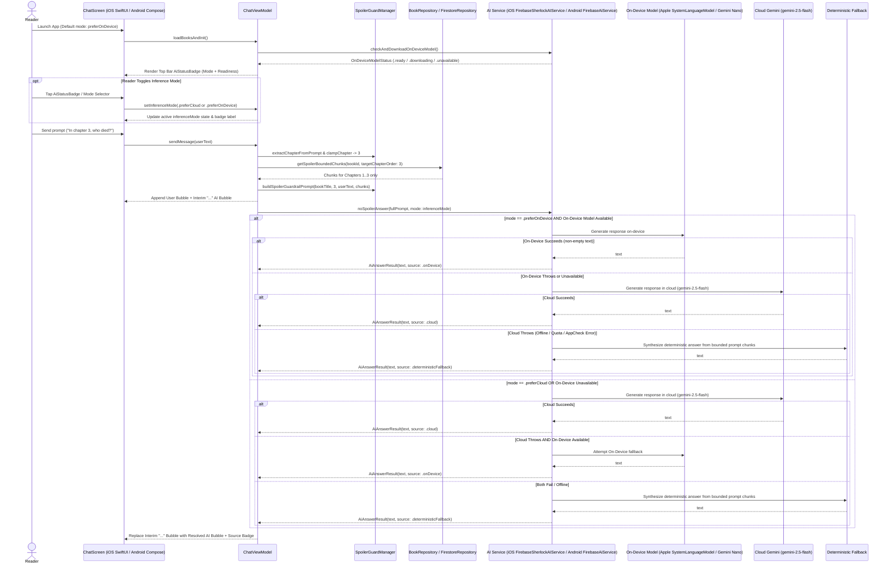

# PRD: On-Device & Hybrid AI Inference for No Spoilers, Sherlock (iOS & Android)

- **Document ID**: `prd-0002-on-device-hybrid-inference`
- **Status**: Draft / Ready for Council of Critics Review
- **Owner**: Product Manager Agent (`@product-manager`)
- **Architect**: Senior Architect Agent (`@senior-architect`)
- **Target Release**: v1.1.0 (iOS 26+ / macOS 26+ / Swift 6 & Android API 26+ / Kotlin 2.3)
- **Target Surfaces**:
  - `frontend/apple/Packages/AppCore/` (Local Swift Package for domain models, `AiInferenceMode`, `AiInferenceSource`, `AiAnswerResult`, `AiServiceProtocol`, `DeterministicSherlockAiService`, and `ChatViewModel` — strictly 100% pure `Foundation` + `Observation` with zero external SPM dependencies)
  - `frontend/apple/no-spoilers-sherlock/` (Native SwiftUI iOS 26+ Application & `FirebaseSherlockAIService`)
  - `frontend/android/` (Native Jetpack Compose Android Application, `FirebaseAiService`, `ChatViewModel`, and `ChatScreen`)

---

## 1. Context & Problem

### 1.1 Background & Current State Audit
"No Spoilers, Sherlock" protects readers of mystery novels (*A Study in Scarlet* and *The Sign of the Four*) from plot spoilers by combining database-level chapter filtering (`chapterOrder <= targetChapterOrder`) with strict LLM system prompt guardrails (`SpoilerGuardManager`). Both the iOS (`frontend/apple/`) and Android (`frontend/android/`) applications display an **"On-Device"** status badge in the top bar when on-device AI capabilities are detected, giving readers the impression that their spoiler-bounded questions are answered locally on their device.

However, a technical audit of both mobile surfaces reveals a gap between the UI indicator and actual runtime execution:

1. **iOS (`frontend/apple/no-spoilers-sherlock/Services/FirebaseSherlockAIService.swift`)**:
   - `checkAndDownloadOnDeviceModel()` inspects `FirebaseAI.SystemLanguageModel.default.isAvailable` and returns `"On-Device AI Ready"`, which causes `AiStatusBadge` in `ChatScreen.swift` to display a green bolt icon and `"On-Device"`.
   - Yet `noSpoilerAnswer(fullPrompt:)` **never invokes the on-device model** (`FirebaseAI.SystemLanguageModel` / `GenerativeModelSession` / Apple `FoundationModels`). Instead, it unconditionally calls `FirebaseAI.firebaseAI(backend: .googleAI()).generativeModel(modelName: "gemini-2.5-flash")` in the cloud, falling back to `DeterministicSherlockAiService` (keyword synthesis) only when the cloud call throws an error.
2. **Android (`frontend/android/app/src/main/java/com/example/nospoilerssherlock/data/FirebaseAiService.kt` & `ui/ChatViewModel.kt`)**:
   - `hybridAIModel` is hardcoded with `OnDeviceConfig(mode = InferenceMode.PREFER_IN_CLOUD)` on `"gemini-3.7-flash"`. Even after `checkAndDownloadOnDeviceModel` downloads Gemini Nano via `hybridAIModel.onDeviceExtension` and updates the top-bar badge to `"On-Device"`, every `noSpoilerAnswer(fullPrompt)` call still routes to the cloud first whenever the device has internet connectivity.
   - Furthermore, Android's `ChatViewModel.sendMessage()` appends an interim `"..."` AI message bubble and then **appends** a second AI message bubble (`_uiState.value.messages + noSpoilerAnswer`) instead of replacing the `"..."` placeholder, leaving an orphaned `"..."` bubble in the chat transcript, and lacks an offline deterministic fallback if `hybridAIModel.generateContent(fullPrompt)` throws while offline without Gemini Nano ready.
3. **Lack of User Control & Source Attribution**:
   - Readers have no way to toggle their preferred inference routing mode (**Prefer On-Device** vs. **Prefer Cloud**) in the top bar, nor can they see on each AI answer bubble whether that specific deduction was executed **On-Device** (Apple Foundation Models / Gemini Nano), in the **Cloud** (Gemini Flash), or via **Offline Fallback** (deterministic casebook synthesis).
   - Period scene illustrations (`generateSceneIllustration`) on both platforms require Cloud Nano Banana (`gemini-3.1-flash-image` / `gemini-2.5-flash-image`) with deterministic fallback, which is not clearly distinguished from text Q&A inference routing.

### 1.2 Target Persona & User Pain Points
- **Privacy- & Latency-Conscious Mystery Readers (iOS & Android)**: Readers on commutes, flights, or low-connectivity environments—or readers with Apple Intelligence / Gemini Nano-capable devices—who expect sub-second, zero-cost local inference when `"On-Device"` is displayed, want explicit control to compare or switch between **On-Device** and **Cloud AI** modes, and want transparent per-message attribution showing where each answer was computed.

---

## 2. Goals & Non-Goals

### 2.1 Goals
- **G-1 (Real On-Device & Hybrid Text Inference on iOS)**: Wire `FirebaseSherlockAIService.noSpoilerAnswer` on iOS 26+ to execute real on-device inference via Firebase AI Logic's `GenerativeModelSession` with `FirebaseAI.SystemLanguageModel.default` / `HybridModel` (backed by Apple's `FoundationModels` framework) when `inferenceMode == .preferOnDevice` and `SystemLanguageModel.default.isAvailable` is `true`, automatically falling back to Cloud Gemini (`gemini-2.5-flash`) and finally to `DeterministicSherlockAiService` when offline or unavailable.
- **G-2 (Real On-Device & Hybrid Text Inference on Android)**: Wire `FirebaseAiService.noSpoilerAnswer` on Android to support dynamic `AiInferenceMode` selection, using `OnDeviceConfig(mode = InferenceMode.PREFER_ON_DEVICE)` when `PREFER_ON_DEVICE` is active (routing to Gemini Nano first with automatic cloud fallback) and `OnDeviceConfig(mode = InferenceMode.PREFER_IN_CLOUD)` when `PREFER_CLOUD` is active, plus a deterministic offline fallback (`DeterministicSherlockFallback`) so offline devices without Gemini Nano never crash or fail silently.
- **G-3 (Interactive Inference Mode Toggle & Per-Message Attribution)**:
  - Upgrade the top-bar `AiStatusBadge` on both iOS (Liquid Glass capsule control) and Android (Material 3 chip/badge) into an interactive mode selector (`preferOnDevice` vs. `preferCloud`) that displays live model readiness (`"On-Device"`, `"Downloading..."`, `"Cloud AI"`, or `"Offline Casebook"`).
  - Display a concise inference source attribution badge on each resolved AI text answer bubble (`"⚡ On-Device AI"`, `"☁️ Cloud Gemini"`, or `"📖 Offline Casebook"`) so the reader always knows how the answer was generated.
- **G-4 (Preserve Two-Layer Spoiler Guardrails & `AppCore` Purity)**:
  - Keep `frontend/apple/Packages/AppCore` 100% pure `Foundation` + `Observation` (+ `ImageIO`/`CoreGraphics` for PNG verification) with **zero external SPM dependencies**.
  - Enforce 100% identical two-layer spoiler guardrails (`SpoilerGuardManager.extractChapterFromPrompt`, `clampChapter`, `getSpoilerBoundedChunks`, and `buildSpoilerGuardrailPrompt`) regardless of whether inference runs on-device, in the cloud, or via deterministic fallback.
- **G-5 (Android Interim Bubble Replacement Parity)**: Fix Android's `ChatViewModel.sendMessage` so the interim `"..."` AI placeholder bubble is **replaced** by the final AI response (or removed on error), matching iOS `AppCore` behavior.

### 2.2 Non-Goals (Out of Scope)
- **NG-1 (On-Device Image Generation)**: Generating Sidney Paget Victorian scene illustrations (`generateSceneIllustration`) on-device is out of scope; scene visualization will continue to use Cloud Nano Banana (`gemini-3.1-flash-image` / `gemini-2.5-flash-image`) with fallback to the pre-encoded Victorian sepia placeholder illustration when offline.
- **NG-2 (Custom Model Fine-Tuning / LoRA Adapters)**: Training or bundling custom FoundationModels `.fmadapter` weights or custom MediaPipe/AICore LoRA weights is out of scope for v1.1.
- **NG-3 (Web or CLI Surface Changes)**: Modifying `frontend/web/` or `backend/cli/` is out of scope for this specification.

---

## 3. User Stories & Workflows

### 3.1 User Stories
- **US-1 (True On-Device Deduction)**: As a reader on an Apple Intelligence-enabled iPhone (iOS 26+) or Gemini Nano-capable Android phone, when the app is in **Prefer On-Device** mode and the on-device model is ready, I want my spoiler-bounded question (e.g., *"In Chapter 3, who was found dead at Lauriston Gardens?"*) to be answered directly by the on-device language model without requiring a network round-trip.
- **US-2 (Seamless Hybrid Fallback)**: As a reader in **Prefer On-Device** mode whose device does not support Apple Intelligence / Gemini Nano (or where on-device generation fails due to context/guardrail constraints), I want the app to automatically and transparently fall back to Cloud Gemini (`gemini-2.5-flash`)—and if offline, to the deterministic casebook synthesizer—so my reading question is always answered without spoilers.
- **US-3 (Interactive Mode Switching)**: As a reader who wants to compare speed and answer style between local and cloud models, I want to tap the AI status control in the top bar to switch between **Prefer On-Device** (`preferOnDevice`) and **Prefer Cloud** (`preferCloud`), and immediately see the top bar reflect my active preference.
- **US-4 (Transparent Per-Answer Attribution)**: As a reader reviewing Sherlock's answer in the chat transcript, I want to see a subtle badge inside the AI message header indicating whether the answer came from **On-Device AI**, **Cloud AI**, or **Offline Casebook** alongside the chapter boundary and cited chapters.
- **US-5 (Clean Interim Placeholder Replacement on Android & iOS)**: As an Android or iOS reader waiting for Sherlock's deduction, I want the temporary `"..."` thinking bubble to be cleanly replaced by the final answer bubble rather than remaining stuck in the chat history.

### 3.2 Hybrid Inference & Mode Switching Workflow

---

### 3.3 Functional Requirements

#### Shared Domain & Inference Models (`FR-1` – `FR-3`)
1. **FR-1 (`AiInferenceMode` & `AiInferenceSource` Models)**:
   - Define `AiInferenceMode` (Swift `enum AiInferenceMode: String, Sendable, Equatable, Codable, CaseIterable` in `AppCore`; Kotlin `enum class AiInferenceMode` in `com.example.nospoilerssherlock.data.models`):
     - `preferOnDevice` (`PREFER_ON_DEVICE`): Default mode. Attempts on-device model execution first when available, falling back to Cloud Gemini and then deterministic offline synthesis.
     - `preferCloud` (`PREFER_CLOUD`): Attempts Cloud Gemini (`gemini-2.5-flash`) first, falling back to on-device (if available) and then deterministic offline synthesis.
   - Define `AiInferenceSource` (Swift `enum AiInferenceSource: String, Sendable, Equatable, Codable` in `AppCore`; Kotlin `enum class AiInferenceSource` in `com.example.nospoilerssherlock.data.models`):
     - `onDevice` (`ON_DEVICE`): Generated locally on-device (Apple `SystemLanguageModel` / `FoundationModels` on iOS; Gemini Nano on Android).
     - `cloud` (`CLOUD`): Generated in the cloud via Firebase AI Logic (Gemini Flash / Nano Banana).
     - `deterministicFallback` (`DETERMINISTIC_FALLBACK`): Generated locally via deterministic keyword synthesis from the spoiler-bounded chapter chunks when both on-device and cloud models are unavailable or offline.
   - Define `AiAnswerResult` (Swift `struct AiAnswerResult: Sendable, Equatable, Codable` in `AppCore`; Kotlin `data class AiAnswerResult` in Android):
     - `text: String`
     - `source: AiInferenceSource`
2. **FR-2 (`ChatMessage` Attribution Extension)**:
   - Extend `ChatMessage` in both `AppCore` (`BookModels.swift`) and Android (`BookModels.kt`) with an optional `inferenceSource: AiInferenceSource? = nil` property while preserving backward compatibility with existing initializers and `isOfflineMode: Bool` (where `isOfflineMode` is `true` when `inferenceSource == .onDevice || inferenceSource == .deterministicFallback`).
3. **FR-3 (`AiServiceProtocol` Hybrid Contract in `AppCore`)**:
   - Extend `AiServiceProtocol` in `frontend/apple/Packages/AppCore/Sources/AppCore/Data/AiServiceProtocol.swift` to support mode-aware inference with source attribution while keeping backward-compatible default implementations for existing callers and tests:
     - `func noSpoilerAnswer(fullPrompt: String, mode: AiInferenceMode) async throws -> AiAnswerResult`
     - Keep `func noSpoilerAnswer(fullPrompt: String) async throws -> String` as a protocol requirement or default extension method so existing tests calling `noSpoilerAnswer(fullPrompt:)` continue to compile and pass without modification.
   - Update `DeterministicSherlockAiService` to implement `noSpoilerAnswer(fullPrompt: String, mode: AiInferenceMode) async throws -> AiAnswerResult`:
     - When `simulatedOnDeviceStatus == "On-Device AI Ready"` and `mode == .preferOnDevice`, returns `AiAnswerResult(text: answer, source: .onDevice)`.
     - When `mode == .preferCloud` and `simulatedOnDeviceStatus != nil`, returns `AiAnswerResult(text: answer, source: .cloud)`.
     - Otherwise (default when `simulatedOnDeviceStatus == nil`), returns `AiAnswerResult(text: answer, source: .deterministicFallback)`.

#### Real On-Device & Hybrid Inference Execution (`FR-4` – `FR-5`)
4. **FR-4 (iOS `FirebaseSherlockAIService` On-Device & Hybrid Execution)**:
   - In `frontend/apple/no-spoilers-sherlock/Services/FirebaseSherlockAIService.swift`:
     - `checkAndDownloadOnDeviceModel()` checks `FirebaseAI.SystemLanguageModel.default.availability`:
       - When `.available`, returns `"On-Device AI Ready"`.
       - When `.unavailable(.modelNotReady)`, returns `"Downloading On-Device AI..."`.
       - Otherwise returns `nil`.
     - `noSpoilerAnswer(fullPrompt: String, mode: AiInferenceMode) async throws -> AiAnswerResult`:
       - **Path A (`mode == .preferOnDevice`)**:
         1. If `FirebaseApp.app() != nil` and `FirebaseAI.SystemLanguageModel.default.isAvailable`:
            - Invokes on-device inference using Firebase AI Logic's `GenerativeModelSession` with `FirebaseAI.SystemLanguageModel.default` (e.g., `ai.generativeModelSession(model: FirebaseAI.SystemLanguageModel.default).respond(to: fullPrompt)`).
            - If a non-empty response string is returned, returns `AiAnswerResult(text: trimmed, source: .onDevice)`.
         2. If on-device is unavailable or throws an error (e.g., guardrail refusal, context window exceeded, or simulator unsupported), automatically falls back to Cloud Gemini (`gemini-2.5-flash` via `ai.generativeModel(modelName: "gemini-2.5-flash").generateContent(fullPrompt)` with limited-use App Check token retry `[false, true]`). If non-empty text is returned, returns `AiAnswerResult(text: trimmed, source: .cloud)`.
         3. If Cloud Gemini also throws or `FirebaseApp.app() == nil`, falls back to `fallbackService.noSpoilerAnswer(fullPrompt: fullPrompt)` and returns `AiAnswerResult(text: fallbackText, source: .deterministicFallback)`.
       - **Path B (`mode == .preferCloud`)**:
         1. Attempts Cloud Gemini (`gemini-2.5-flash`) first; on success, returns `AiAnswerResult(text: trimmed, source: .cloud)`.
         2. If Cloud Gemini fails and `FirebaseAI.SystemLanguageModel.default.isAvailable` is `true`, attempts on-device `FirebaseAI.SystemLanguageModel.default`; on success, returns `AiAnswerResult(text: trimmed, source: .onDevice)`.
         3. Otherwise falls back to `DeterministicSherlockAiService` and returns `AiAnswerResult(text: fallbackText, source: .deterministicFallback)`.
5. **FR-5 (Android `FirebaseAiService` On-Device, Cloud, & Deterministic Fallback)**:
   - In `frontend/android/app/src/main/java/com/example/nospoilerssherlock/data/FirebaseAiService.kt`:
     - Maintain two configured Firebase AI Logic generative models (or dynamically select by `AiInferenceMode`):
       - `preferOnDeviceModel`: configured with `modelName = "gemini-2.5-flash"` and `onDeviceConfig = OnDeviceConfig(mode = InferenceMode.PREFER_ON_DEVICE)`.
       - `preferCloudModel`: configured with `modelName = "gemini-2.5-flash"` and `onDeviceConfig = OnDeviceConfig(mode = InferenceMode.PREFER_IN_CLOUD)`.
       - `onlyOnDeviceModel` (or `preferOnDeviceModel.onDeviceExtension`): used to check `OnDeviceModelStatus` and determine whether on-device Gemini Nano is `AVAILABLE`.
     - Implement `suspend fun noSpoilerAnswer(fullPrompt: String, mode: AiInferenceMode = AiInferenceMode.PREFER_ON_DEVICE): AiAnswerResult`:
       - When `mode == AiInferenceMode.PREFER_ON_DEVICE`:
         - Check if `onDeviceExtension?.checkStatus() == OnDeviceModelStatus.AVAILABLE`.
         - Execute `preferOnDeviceModel.generateContent(fullPrompt)`. If non-blank text is returned, attribute `source = if (isOnDeviceAvailable) AiInferenceSource.ON_DEVICE else AiInferenceSource.CLOUD`.
         - If `preferOnDeviceModel` throws an exception, attempt `preferCloudModel.generateContent(fullPrompt)` (`source = AiInferenceSource.CLOUD`), and if that also throws or returns blank, fall back to a local `DeterministicSherlockFallback.noSpoilerAnswer(fullPrompt)` returning `AiAnswerResult(text, AiInferenceSource.DETERMINISTIC_FALLBACK)`.
       - When `mode == AiInferenceMode.PREFER_CLOUD`:
         - Execute `preferCloudModel.generateContent(fullPrompt)` (`source = AiInferenceSource.CLOUD`).
         - On failure, attempt `preferOnDeviceModel` if `OnDeviceModelStatus.AVAILABLE`, and finally fall back to `DeterministicSherlockFallback.noSpoilerAnswer(fullPrompt)` (`source = AiInferenceSource.DETERMINISTIC_FALLBACK`).

#### ViewModel State & UI Controls (`FR-6` – `FR-8`)
6. **FR-6 (`ChatViewModel` Inference Mode Management & Interim Bubble Replacement)**:
   - On both iOS (`AppCore/ViewModel/ChatViewModel.swift`) and Android (`ui/ChatViewModel.kt`):
     - Expose `inferenceMode: AiInferenceMode` defaulting to `.preferOnDevice` (`AiInferenceMode.PREFER_ON_DEVICE`).
     - Provide `setInferenceMode(_ mode: AiInferenceMode)` / `toggleInferenceMode()` to allow the user to switch between `.preferOnDevice` and `.preferCloud` at any time without losing their current chat transcript.
     - During `sendMessage(userText)`:
       - Update `statusMessage` while loading to reflect both the chapter boundary and active mode (e.g., `"Restricting spoiler boundary to Chapter \(clampedChapter) of \(activeBook.title)..."`).
       - Call `aiService.noSpoilerAnswer(fullPrompt: fullPrompt, mode: inferenceMode)`.
       - Construct the resolved `.ai` `ChatMessage` with `inferenceSource = result.source` and `isOfflineMode = (result.source == .onDevice || result.source == .deterministicFallback)`.
       - **Replace** the interim `"..."` placeholder message in `messages` by matching its `id` (fixing Android's duplicate `"..."` bubble bug so `messages` contains `[welcomeMessage, userMessage, resolvedAiMessage]` after 1 query).
7. **FR-7 (Interactive Top-Bar `AiStatusBadge` / Mode Selector)**:
   - On **iOS (`ChatScreen.swift`)**:
     - Upgrade `AiStatusBadge` in the top `GlassEffectContainer` to an interactive `Menu` or `Button` styled with `.buttonStyle(.glass)` and `.buttonBorderShape(.capsule)` (or `.glassEffect(.regular, in: .capsule)`) with accessibility identifier `"aiStatusBadge"`:
       - Allows selecting between **"Prefer On-Device AI"** (`bolt.fill`) and **"Prefer Cloud AI"** (`cloud.fill`).
       - Displays `"On-Device"` (green `bolt.fill`) when `inferenceMode == .preferOnDevice` and `onDeviceStatus` contains `"Ready"`; `"Downloading..."` (progress spinner) when `onDeviceStatus` contains `"Downloading"`; `"Hybrid (Cloud)"` or `"Cloud AI"` (`cloud.fill`) when `inferenceMode == .preferCloud` or on-device AI is unavailable on the current hardware.
       - Persists the user's selected mode via `@AppStorage("preferredInferenceMode")` (optional enhancement) or binds directly to `viewModel.inferenceMode`.
   - On **Android (`ChatScreen.kt`)**:
     - Upgrade `AiStatusBadge` in the `TopAppBar` to be clickable (`Modifier.clickable` / `Surface` or `FilterChip`), toggling `viewModel.toggleInferenceMode()` (or opening a mode menu) between `AiInferenceMode.PREFER_ON_DEVICE` and `AiInferenceMode.PREFER_CLOUD`, and clearly displaying:
       - `"On-Device"` (`Icons.Default.Bolt`) when `inferenceMode == PREFER_ON_DEVICE` and `onDeviceStatus` is `"On-Device AI Ready"`.
       - `"Downloading..."` (`CircularProgressIndicator`) when downloading Gemini Nano.
       - `"Cloud AI"` (`Icons.Default.Cloud`) when `inferenceMode == PREFER_CLOUD` or when on-device Gemini Nano is unavailable.
8. **FR-8 (Per-Message Inference Source Attribution in `ModernMessageBubble`)**:
   - On both **iOS (`ModernMessageBubble.swift`)** and **Android (`ChatScreen.kt` -> `ModernMessageBubble`)**:
     - For resolved `.ai` messages (`message.sender == .ai && message.text != "..."`), display the inference source attribution alongside the chapter boundary / citation metadata:
       - `.onDevice` / `ON_DEVICE`: `"⚡ On-Device"`
       - `.cloud` / `CLOUD`: `"☁️ Cloud AI"`
       - `.deterministicFallback` / `DETERMINISTIC_FALLBACK`: `"📖 Offline Casebook"`
     - On iOS, keep `ModernMessageBubble` free of `.glassEffect` inside `ScrollView` to preserve 60/120fps scrolling performance per `apple-flo-liquid-glass` guidelines.

---

## 4. Technical Considerations

### 4.1 Cross-Platform SDK & Compiler Constraints
- **iOS (`frontend/apple/`)**:
  - `firebase-ios-sdk` v12.19.2 (`FirebaseAI`) includes `FirebaseAI.SystemLanguageModel`, `HybridModel`, and `GenerativeModelSession` guarded by `#if compiler(>=6.2.3)` and `@available(iOS 26.0, macOS 26.0, *)`.
  - When `FirebaseAI.SystemLanguageModel.default.isAvailable` is `true`, `FirebaseSherlockAIService` can invoke `FirebaseAI.firebaseAI(backend: .googleAI(), useLimitedUseAppCheckTokens: useLimitedUseTokens).generativeModelSession(model: FirebaseAI.SystemLanguageModel.default).respond(to: fullPrompt)` (or directly use Apple's `FoundationModels.LanguageModelSession(model: .default).respond(to: fullPrompt)` if `GenerativeModelSession` requires specific compiler flags), and fall back to `generativeModel(modelName: "gemini-2.5-flash")` on any error.
  - On iOS Simulator or Macs where Apple Intelligence is not enabled (`SystemLanguageModel.default.isAvailable == false`), `checkAndDownloadOnDeviceModel()` accurately returns `nil` (or the unavailability status) and `noSpoilerAnswer` seamlessly routes to Cloud Gemini (`gemini-2.5-flash`) and then `DeterministicSherlockAiService`.
- **Android (`frontend/android/`)**:
  - Uses `com.google.firebase:firebase-bom:34.18.0`, `com.google.firebase:firebase-ai`, and `com.google.firebase:firebase-ai-ondevice:16.0.0-beta05` with `@OptIn(PublicPreviewAPI::class)`.
  - Standardizes cloud model name to `"gemini-2.5-flash"` (replacing `"gemini-3.7-flash"`, which is not a valid production Gemini model identifier in Firebase AI Logic) while keeping `"gemini-3.1-flash-image"` (with `"gemini-2.5-flash-image"` fallback) for Nano Banana scene illustrations.
  - Because `Firebase.ai` initializes the Firebase SDK, unit tests in `frontend/android/app/src/test` must be able to test `DeterministicSherlockFallback`, `SpoilerGuardManager`, and `ChatViewModel` (via constructor-injected or interface-wrapped dependencies) on the local JVM without requiring a live Android device or Play Services runtime.

### 4.2 Strict Preservation of `AppCore` Zero-Dependency Boundary
- `frontend/apple/Packages/AppCore/Package.swift` MUST NOT import `FirebaseAI`, `FirebaseCore`, or `FoundationModels` if doing so introduces external SPM dependencies or breaks `swift test --package-path frontend/apple/Packages/AppCore`. All `FirebaseAI` and `FoundationModels` calls belong strictly in `frontend/apple/no-spoilers-sherlock/Services/FirebaseSherlockAIService.swift`.

### 4.3 Security, App Check, & Two-Layer Spoiler Safety
- **Spoiler Guardrail Invariance**: On-device language models (Apple Foundation Models ~3B parameters and Android Gemini Nano) have smaller context windows and may follow complex formatting instructions differently than Cloud Gemini 2.5 Flash. Because Layer 1 (`getSpoilerBoundedChunks(bookId, targetChapterOrder)`) physically excludes all database chunks with `chapterOrder > targetChapterOrder` before the prompt is constructed, the on-device model never receives future chapter facts in its context window.
- **App Check**: Cloud fallback requests in `FirebaseSherlockAIService` and `FirebaseAiService` continue to support `useLimitedUseAppCheckTokens` and debug App Check providers without hardcoding debug tokens in source code.

---

## 5. Numbered Testable Acceptance Criteria

- [ ] **AC-1 (`AiInferenceMode`, `AiInferenceSource`, & `AiAnswerResult` Domain Models)**: Given `AppCore` on iOS and `com.example.nospoilerssherlock.data.models` on Android, `AiInferenceMode` defines `preferOnDevice` (`PREFER_ON_DEVICE`) and `preferCloud` (`PREFER_CLOUD`), `AiInferenceSource` defines `onDevice` (`ON_DEVICE`), `cloud` (`CLOUD`), and `deterministicFallback` (`DETERMINISTIC_FALLBACK`), and `ChatMessage` includes `inferenceSource: AiInferenceSource?`.
- [ ] **AC-2 (Mode-Aware `AiServiceProtocol` & Deterministic Service Attribution)**: Given `DeterministicSherlockAiService` in `AppCore`, when `noSpoilerAnswer(fullPrompt:mode:)` is called with `mode == .preferOnDevice` and `simulatedOnDeviceStatus == "On-Device AI Ready"`, then it returns `AiAnswerResult` with `source == .onDevice`; when called with `mode == .preferCloud` and `simulatedOnDeviceStatus == "On-Device AI Ready"`, it returns `source == .cloud`; when `simulatedOnDeviceStatus == nil`, it returns `source == .deterministicFallback`.
- [ ] **AC-3 (iOS Real On-Device & Hybrid Fallback Wiring in `FirebaseSherlockAIService`)**: Given `FirebaseSherlockAIService` on iOS 26+, when `noSpoilerAnswer(fullPrompt:mode:)` is called with `mode == .preferOnDevice` and `FirebaseAI.SystemLanguageModel.default.isAvailable == true`, it invokes on-device inference via `SystemLanguageModel` (`GenerativeModelSession` / `FoundationModels`) first and returns `source == .onDevice` on success; if on-device is unavailable or throws, it automatically falls back to Cloud Gemini (`gemini-2.5-flash`, `source == .cloud`) and finally to `DeterministicSherlockAiService` (`source == .deterministicFallback`).
- [ ] **AC-4 (Android Real `PREFER_ON_DEVICE` & `PREFER_IN_CLOUD` Routing with Deterministic Fallback)**: Given `FirebaseAiService` on Android, `preferOnDeviceModel` is configured with `OnDeviceConfig(mode = InferenceMode.PREFER_ON_DEVICE)` and `preferCloudModel` is configured with `OnDeviceConfig(mode = InferenceMode.PREFER_IN_CLOUD)` using `"gemini-2.5-flash"`; when both cloud and on-device inference fail or throw (e.g., offline without Gemini Nano), `noSpoilerAnswer` returns a spoiler-bounded answer from `DeterministicSherlockFallback` with `source == AiInferenceSource.DETERMINISTIC_FALLBACK` instead of crashing.
- [ ] **AC-5 (`ChatViewModel` Inference Mode Switching & Attribution Propagation)**: Given `ChatViewModel` on both iOS and Android, the default `inferenceMode` is `preferOnDevice` (`PREFER_ON_DEVICE`); calling `setInferenceMode(.preferCloud)` or `toggleInferenceMode()` updates `inferenceMode` to `preferCloud` (`PREFER_CLOUD`) without clearing existing messages, and subsequent `sendMessage(_:)` calls pass the active `inferenceMode` to the AI service and store the returned `AiInferenceSource` on the resolved `.ai` `ChatMessage`.
- [ ] **AC-6 (Android & iOS Interim `"..."` Bubble Replacement Parity)**: Given an initialized `ChatViewModel` on either iOS or Android (`messages.count == 1` welcome message), when `sendMessage("In chapter 3, who died?")` completes, the interim `"..."` AI placeholder bubble is replaced in-place by the final AI response bubble so `messages.count == 3` (`[welcomeMessage, userMessage, resolvedAiMessage]`) and zero messages with `text == "..."` remain in `messages`.
- [ ] **AC-7 (Interactive Top-Bar `AiStatusBadge` & Per-Bubble Source Attribution UI)**: Given `ChatScreen` and `ModernMessageBubble` on both iOS and Android, the top-bar `AiStatusBadge` allows switching between `preferOnDevice` and `preferCloud` modes, and each resolved AI message bubble displays a human-readable source attribution label (`"⚡ On-Device"`, `"☁️ Cloud AI"`, or `"📖 Offline Casebook"`) alongside its chapter boundary badge.
- [ ] **AC-8 (Zero External Dependencies in `AppCore` & 100% Test Suite Pass Rate)**: Given the completed implementation across iOS and Android, `frontend/apple/Packages/AppCore/Package.swift` has zero third-party package dependencies, and all three verification suites pass 100%:
  1. `swift test --package-path frontend/apple/Packages/AppCore`
  2. `flowdeck test -w frontend/apple/no-spoilers-sherlock.xcodeproj -s no-spoilers-sherlock`
  3. `(cd frontend/android && ./gradlew test)`

---

## 6. Handoff to Senior Architect (`@senior-architect`)

- **Artifact Path**: [`docs/specs/prd-0002-on-device-hybrid-inference.md`](file:///Users/peterfriese/Workspace/Projects/CCDR/S2E4/live/no-spoilers-sherlock/docs/specs/prd-0002-on-device-hybrid-inference.md)
- **Next Step**: Hand off to `@senior-architect` and the Council of Critics (`Feasibility Critic`, `Scope Guardian Critic`, `Coherence Critic`, `Risk & Security Critic`) to validate technical feasibility, scope alignment, cross-platform coherence, and spoiler guardrail security before implementation.
